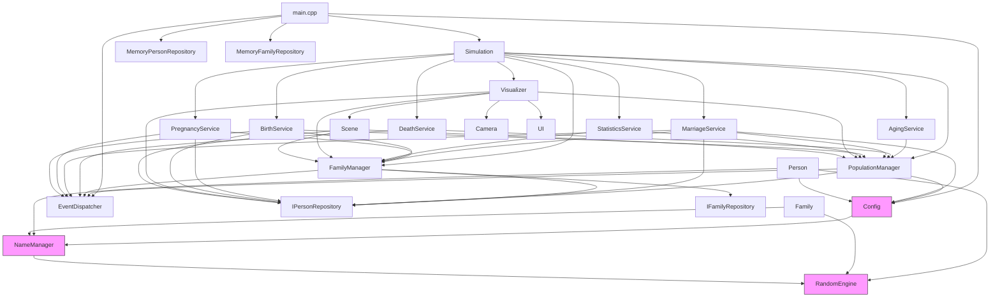

# Архитектурный аудит — ftree

## 1. Обзор

Проект `ftree` — это симуляция семьи на C++17 с CMake и SFML для визуализации. Он моделирует жизнь, смерть, брак, рождение и старение людей в семейных структурах.

## 2. Структура проекта

```
/home/evilfox/ftree/
├── CMakeLists.txt                 # Конфигурация сборки (SFML 2.5, C++17)
├── AGENT_RULES.md                 # Правила разработки
├── config/
│   ├── simulation.cfg             # Параметры симуляции
│   ├── male_names.txt             # Мужские имена
│   ├── female_names.txt           # Женские имена
│   └── surnames.txt               # Фамилии
├── assets/
│   ├── arial.ttf
│   └── font.otf
├── include/                       # Открытые заголовочные файлы
│   ├── core/                      # Simulation, Config, RandomEngine, EventDispatcher
│   ├── entities/                  # Person, Family, Gender
│   ├── entities/repos/            # Интерфейсы репозиториев и реализации in-memory
│   ├── managers/                  # PopulationManager, FamilyManager, NameManager
│   ├── services/                  # Aging, Birth, Death, Marriage, Pregnancy, Statistics
│   └── vizualization/             # Visualizer, Camera, Scene, UI
├── src/
│   ├── core/
│   ├── entites/                   # Примечание: имя каталога написано с ошибкой ("entites" вместо "entities")
│   ├── managers/
│   ├── services/
│   ├── utils/
│   ├── vizualization/
│   └── main.cpp
├── build/                         # Каталог сборки (в gitignore)
├── docs/
│   ├── core/                      # Существующая документация
│   └── refactoring/               # Новые документы по рефакторингу
└── prompts/                       # Задачи-промпты
```

## 3. Архитектура

### 3.1 Ядро предметной области

| Класс | Файл | Ответственность |
|-------|------|-----------------|
| `Person` | `include/entities/Person.hpp`, `src/entites/Person.cpp` | Индивид с UUID, полом, возрастом, родителями (weak_ptr), семьей (weak_ptr), беременностью, жизнью/смертью, именем |
| `Family` | `include/entities/Family.hpp`, `src/entites/Family.cpp` | Семья с матерью, отцом (weak_ptr), детьми (vector<weak_ptr>), фамилией |
| `Gender` | `include/entities/Gender.hpp` | Перечисление: Male, Female |

### 3.2 Слой репозиториев

| Класс | Файл | Ответственность |
|-------|------|-----------------|
| `IPersonRepository` | `include/entities/repos/IPersonRepository.hpp` | Интерфейс доступа к персонажам |
| `IFamilyRepository` | `include/entities/repos/IFamilyRepository.hpp` | Интерфейс доступа к семьям |
| `MemoryPersonRepository` | `include/entities/repos/MemoryPersonRepository.hpp` | Реализация in-memory с мьютексом |
| `MemoryFamilyRepository` | `include/entities/repos/MemoryFamilyRepository.hpp` | Реализация in-memory с мьютексом |

### 3.3 Слой менеджеров

| Класс | Файл | Ответственность |
|-------|------|-----------------|
| `PopulationManager` | `include/managers/PopulationManager.hpp` | Добавить/удалить персонажа, старение, поиск партнёров, проверка родства |
| `FamilyManager` | `include/managers/FamilyManager.hpp` | Создать/распустить семью, добавить детей в семью |
| `NameManager` | `include/managers/NameManager.hpp` | Singleton: случайные имена и фамилии из файлов конфигурации |

### 3.4 Слой сервисов

| Класс | Файл | Ответственность |
|-------|------|-----------------|
| `AgingService` | `include/services/AgingService.hpp` | Увеличивает возраст всех живых на 1 |
| `DeathService` | `include/services/DeathService.hpp` | Обрабатывает смерть на основе вероятности |
| `MarriageService` | `include/services/MarriageService.hpp` | Женит отдельных людей на основе разницы возрастов |
| `PregnancyService` | `include/services/PregnancyService.hpp` | Обрабатывает зачатие для женатых пар |
| `BirthService` | `include/services/BirthService.hpp` | Обрабатывает роды у беременных женщин |
| `StatisticsService` | `include/utils/StatisticsService.hpp` | Выводит статистику населения по годам |

### 3.5 Ядро

| Класс | Файл | Ответственность |
|-------|------|-----------------|
| `Simulation` | `include/core/Simulation.hpp`, `src/core/Simulation.cpp` | Оркестратор: хранит все менеджеры и сервисы, выполняет годы симуляции |
| `Config` | `include/core/Config.hpp`, `src/core/Config.cpp` | Singleton: конфигурация ключ-значение из файла |
| `RandomEngine` | `include/core/RandomEngine.hpp`, `src/core/RandomEngine.cpp` | Singleton: генератор случайных чисел (mt19937) |
| `EventDispatcher` | `include/core/EventDispatcher.hpp`, `src/core/EventDispatcher.cpp` | Система публикации/подписки на события с защитой мьютексом |

### 3.6 Визуализация (SFML)

| Класс | Файл | Ответственность |
|-------|------|-----------------|
| `Visualizer` | `include/vizualization/Visualizer.hpp` | Главное окно, координирует Camera, Scene, UI |
| `Scene` | `include/vizualization/Scene.hpp` | Рисует макет генеалогического древа |
| `Camera` | `include/vizualization/Camera.hpp` | Управление панорамированием и зумом |
| `UI` | `include/vizualization/UI.hpp` | Информационные панели, статус симуляции, подсказки управления |

### 3.7 Поток данных одной итерации симуляции

```
processSingleYear():
  1. AgingService.processAging()        → все живые +1 год
  2. DeathService.processDeaths()       → люди умирают с cierta вероятностью
  3. MarriageService.processMarriages() → одинокие люди женятся
  4. PregnancyService.processPregnancies() → женатые пары зачинают детей
  5. BirthService.processBirths()       → беременные женщины рожают
  6. StatisticsService.printStatistics() → статистика года
```

События публикуются через `EventDispatcher` (PersonBorn, PersonDied, Marriage, Pregnancy, Childbirth, FamilyCreated, FamilyDissolved, PersonMoved).

## 4. Зависимости (Dependency Graph)

```
main.cpp
  ├── Config (Singleton)
  ├── MemoryPersonRepository
  ├── MemoryFamilyRepository
  ├── EventDispatcher
  └── Simulation
      ├── PopulationManager
      │   ├── IPersonRepository
      │   ├── EventDispatcher
      │   └── Config (Singleton)
      ├── FamilyManager
      │   ├── IFamilyRepository
      │   ├── IPersonRepository
      │   └── EventDispatcher
      ├── AgingService
      │   └── PopulationManager
      ├── DeathService
      │   ├── PopulationManager
      │   └── EventDispatcher
      ├── MarriageService
      │   ├── FamilyManager
      │   ├── PopulationManager
      │   ├── IPersonRepository
      │   ├── EventDispatcher
      │   └── Config (Singleton)
      ├── PregnancyService
      │   ├── FamilyManager
      │   ├── IPersonRepository
      │   └── EventDispatcher
      ├── BirthService
      │   ├── PopulationManager
      │   ├── FamilyManager
      │   ├── IPersonRepository
      │   └── EventDispatcher
      └── StatisticsService
          ├── PopulationManager
          └── FamilyManager
      └── Visualizer (если визуализация активна)
          ├── FamilyManager
          ├── PopulationManager
          ├── IPersonRepository
          ├── Camera (SFML)
          ├── Scene
          │   ├── FamilyManager
          │   ├── PopulationManager
          │   └── IPersonRepository
          └── UI
              ├── PopulationManager
              ├── FamilyManager
              └── IPersonRepository

Singleton-зависимости (используются глобально):
  Config          → от Person, Family, сервисов, менеджеров, Simulation
  RandomEngine    → от Person, Family, NameManager, сервисов
  NameManager     → от Person, Family
```



## 5. Найденные проблемы

### 5.1 Подтверждённые проблемы (проверены по исходному коду)

#### Проблема 1: SFML не установлен — сборка не проходит

**Файл:** `CMakeLists.txt` строка 10
**Что происходит:** `find_package(SFML 2.5 COMPONENTS graphics window system REQUIRED)` завершается ошибкой, так как SFML не установлен.
**Почему это проблема:** Проект невозможно скомпилировать. Без рабочей сборки нельзя проверить изменения.
**Риск:** Полный останов сборки.
**Исправление:** Установить SFML (`libsfml-dev`) или добавить конфигурацию сборки без SFML.

#### Проблема 2: Тесты отсутствуют

**Файл:** Проектwide (тестовые файлы не найдены)
**Что происходит:** Нет никаких модульных или интеграционных тестов.
**Почему это проблема:** Изменения в логике домены невозможно автоматически проверить. Рефакторинг рискован.
**Риск:** Регрессионные ошибки на каждом этапе изменений.
**Исправление:** Интегрировать GoogleTest и создать базовые тесты для доменной логики.

#### Проблема 3: Опечатка в имени каталога `src/entites/` вместо `src/entities/`

**Файл:** `CMakeListas.txt` строки 26-27, каталог `src/entites/`
**Что происходит:** Каталог исходников называется `entites` (пропущена буква 'i') вместо `entities`, хотя каталог включений называется правильно `entities`.
**Почему это проблема:** Неконсистентное наименование, запутывает разработчиков.
**Риск:** Низкий, но препятствует поддержке.
**Исправление:** Переименовать каталог в `entities/` и обновить CMakeLists.txt.

#### Проблема 4: Config-Singleton не потокобезопасен

**Файл:** `include/core/Config.hpp`, `src/core/Config.cpp`
**Что происходит:** `Config` использует Singleton. Создание экземпляра потокобезопасно (статическая локальная переменная), но все методы (`loadFromFile`, `set`, `getDouble`, `getInt`, `getString`) обращаются к `values` без мьютекса.
**Почему это проблема:** Несколько сервисов вызывают `Config::getInstance()` одновременно. При будущей многопоточности возникнут гонки данных.
**Риск:** Неопределённое поведение при параллельном доступе.
**Исправление:** Добавить мьютекс в Config или задокументировать, что Config загружается только до запуска симуляции.

#### Проблема 5: RandomEngine-Singleton не потокобезопасен

**Файл:** `include/core/RandomEngine.hpp`, `src/core/RandomEngine.cpp`
**Что происходит:** `RandomEngine` — Singleton. `getEngine()` возвращает прямую ссылку на внутренний `std::mt19937` без защиты мьютексом. `std::mt19937` не потокобезопасен. Несколько сервисов вызывают `RandomEngine::getInstance()`.
**Риск:** Гонки данных при параллельном использовании.
**Исправление:** Добавить защиту мьютексом или задокументировать последовательность.

#### Проблема 6: NameManager-Singleton не потокобезопасен

**Файл:** `include/managers/NameManager.hpp`, `src/managers/NameManager.cpp`
**Что происходит:** `NameManager` — Singleton. `maleNames`, `femaleNames`, `surnames` модифицируются и читаются без мьютекса.
**Риск:** Гонки данных.
**Исправление:** См. проблемы 4/5.

#### Проблема 7: ID для новых персонажей и семей не уникальны после удалений

**Файл:** `src/core/Simulation.cpp` строки 31/37, `src/services/BirthService.cpp` строка 49, `src/managers/FamilyManager.cpp` строка 20
**Что происходит:** `size() + 1` используется для новых ID. Если объекты удалены, `size()` уменьшается, и новые объекты получают дублирующиеся ID.
**Почему это проблема:** Дубликаты ID приводят к неверным записям в репозитории (перезапись вместо добавления).
**Риск:** Порча данных, потеря персонажей/семей.
**Исправление:** Ввести отдельный генератор ID (монотонно растущий счётчик).

#### Проблема 8: DeathService не удаляет мёртвых персонажей из репозитория

**Файл:** `src/services/DeathService.cpp` строки 9-21
**Что происходит:** `processDeaths()` вызывает `person->tryDie()`, публикует событие `PersonDied`, но nunca вызывает `removePerson()` или `personRepository->remove()`. Персонаж остаётся в репозитории,只是 помечен как `alive=false`.
**Почему это проблема:** Мёртвые персонажи остаются в репозитории и возвращаются через `getAll()`. Сервисы, использующие `getAll()` (например, `BirthService` для генерации ID), учитывают мёртвых.
**Риск:** Потребление памяти растёт無駄, генерация ID неверна (см. проблему 7), потенциальные логические ошибки.
**Исправление:** После помечения как мёртвый, удалить персонажа из репозитория или гарантировать, что все сервисы используют только `getLiving()`.

#### Проблема 9: Потенциальный разыменование нулевого указателя в PregnancyService

**Файл:** `src/services/PregnancyService.cpp` строки 14-15
**Что происходит:** `family->getMother()->getUuid()` и `family->getFather()->getUuid()` без проверки на null. Если `weak_ptr` истек, результат — `nullptr`, и вызов `->getUuid()` приводит к Segfault.
**Почему это проблема:** Если мать или отец удалены из репозитория, но семья всё ещё существует, симуляция упадёт.
**Риск:** Аварийное завершение симуляции.
**Исправление:** Добавить проверки на null перед доступом к `getMother()`/`getFather()`.

#### Проблема 10: Неверное условие возраста в MarriageService::findEligiblePartners

**Файл:** `src/managers/PopulationManager.cpp` строки 66-69
**Что происходит:**
```cpp
if (partner->getAge() > minMarriageAge && partner->getAge() > maxPersonAge) {
    continue;
}
```
Это условие пропускает партнёров только если они старше `minMarriageAge` И старше `maxPersonAge`. Партнёры моложе `minMarriageAge` не отфильтровываются.
**Правильно:** `partner->getAge() < minMarriageAge || partner->getAge() > maxPersonAge`
**Почему это проблема:** Несовершеннолетние могут быть выбраны в качестве партнёров.
**Риск:** Неверная логика симуляции.
**Исправление:** Исправить условие.

#### Проблема 11: EventDispatcher удерживает мьютекс во время выполнения обработчиков

**Файл:** `include/core/EventDispatcher.hpp`, `src/core/EventDispatcher.cpp` строки 24-32
**Что происходит:** `publish()` блокирует мьютекс и вызывает все обработчики для типа события, пока мьютекс всё ещё удерживается.
**Почему это проблема:** Если обработчик сам вызывает `publish()` (повторная публикация), возникнет взаимная блокировка (deadlock).
**Риск:** Deadlock при будущем расширении обработчиков событий.
**Исправление:** Сделать копию обработчиков, освободить мьютекс, затем вызвать обработчики.

#### Проблема 12: MemoryPersonRepository::update имеет неверную структуру скобок

**Файл:** `include/entities/repos/MemoryPersonRepository.hpp` строки 32-37
**Что происходит:** Структура скобок запутанная (блок `if` не закрыт корректно, закрывающая `}` относится к функции). Компилируется, но ошибкоопасно.
**Риск:** Препятствие поддержке, потенциальные будущие ошибки при изменениях.
**Исправление:** Ясная структура скобок.

#### Проблема 13: Относительные пути для конфигурации и ассетов

**Файл:** `src/main.cpp` строка 12, `src/vizualization/Visualizer.cpp` строки 13, 17, `src/core/Config.cpp` строки 32-37
**Что происходит:** Пути вроде `"../config/simulation.cfg"` и `"../assets/font.otf"` относительны к рабочему каталогу.
**Почему это проблема:** Программа работает только при запуске из каталога проекта. При установке или другом рабочем каталоге загрузка файлов завершается молчаливой ошибкой.
**Риск:** Конфигурация и шрифты не загружаются.
**Исправление:** Использовать абсолютные пути или пути относительно исполняемого файла.

#### Проблема 14: Simulation::simulateYears блокируется на ввод пользователя без визуализации

**Файл:** `src/core/Simulation.cpp` строки 53-57
**Что происходит:** Без визуализации `simulateYears()` ожидает `std::cin.ignore()` после каждого года.
**Почему это проблема:** Автоматический запуск (например, для тестов или пакетной симуляции) невозможен без ручного ввода.
**Риск:** Нет возможности автоматизированных симуляций.
**Исправление:** Опция headless-режима без ввода пользователя.

#### Проблема 15: AgingService не обновляет репозиторий после старения

**Файл:** `src/services/AgingService.cpp` строки 7-11
**Что происходит:** `processAging()` вызывает `person->incrementAge()` напрямую на shared_ptr. Nunca вызывается `personRepository->update(person)`. Поскольку это те же объекты shared_ptr, изменения видны, но интерфейс репозитория предполагает `update()`, который не используется.
**Почему это проблема:** Неконсистентное использование паттерна репозитория. Если репозиторий в будущем будет скопирован или проксирован, изменения потеряются.
**Риск:** Будущие ошибки при изменении репозитория.
**Исправление:** Вызвать `update()` после `incrementAge()` или задокументировать, что shared_ptr модифицируются напрямую.

#### Проблема 16: DeathService не растворяет семью при смерти супруга

**Файл:** `src/services/DeathService.cpp`
**Что происходит:** Когда человек умирает, его семья не растворяется. Выживший супруг остаётся в семье.
**Риск:** Неконсистентное семейное состояние.
**Исправление:** При смерти супруга растворять семью или удалять выжившего партнёра из семьи.

### 5.2 Допущения (не проверены по исходному коду)

Дополнительных допущений не зафиксировано. Все вышеперечисленные проблемы подтверждены анализом исходного кода.

## 6. Топ-5 проблем для приоритизации

| Приоритет | Проблема | Затронутые файлы |
|-----------|----------|-----------------|
| 1 | SFML не установлен — сборка не проходит | `CMakeLists.txt` |
| 2 | Тесты отсутствуют | Проектwide |
| 3 | ID для персонажей/семей не уникальны после удалений | `src/services/BirthService.cpp`, `src/managers/FamilyManager.cpp`, `src/core/Simulation.cpp` |
| 4 | DeathService не удаляет мёртвых из репозитория | `src/services/DeathService.cpp` |
| 5 | Потенциальный разыменование нулевого указателя в PregnancyService | `src/services/PregnancyService.cpp` |

## 7. Следующие шаги

1. Установить SFML и проверить сборку
2. Настроить тестовую инфраструктуру (GoogleTest)
3. Создать план рефакторинга (см. docs/refactoring/refactoring-roadmap.md)
4. Исправлять проблемы в порядке приоритета
