# Graf зависимостей — ftree

Этот документ описывает статические зависимости между компонентами проекта.

## 1. Зависимости включений (уровень заголовочных файлов)

```
main.cpp
├── core/Simulation.hpp
├── entities/repos/MemoryPersonRepository.hpp
├── entities/repos/MemoryFamilyRepository.hpp
├── core/EventDispatcher.hpp
├── core/Config.hpp
└── managers/NameManager.hpp

core/Simulation.hpp
├── entities/repos/IPersonRepository.hpp
├── entities/repos/IFamilyRepository.hpp
├── core/EventDispatcher.hpp
├── managers/PopulationManager.hpp
├── managers/FamilyManager.hpp
├── vizualization/Visualizer.hpp
├── services/AgingService.hpp
├── services/DeathService.hpp
├── services/MarriageService.hpp
├── services/PregnancyService.hpp
├── services/BirthService.hpp
└── utils/StatisticsService.hpp

managers/PopulationManager.hpp
├── entities/repos/IPersonRepository.hpp
├── core/EventDispatcher.hpp
└── core/Config.hpp

managers/FamilyManager.hpp
├── entities/repos/IFamilyRepository.hpp
├── entities/repos/IPersonRepository.hpp
└── core/EventDispatcher.hpp

managers/NameManager.hpp
├── entities/Gender.hpp
└── core/RandomEngine.hpp

services/AgingService.hpp
└── managers/PopulationManager.hpp

services/DeathService.hpp
├── managers/PopulationManager.hpp
└── core/EventDispatcher.hpp

services/MarriageService.hpp
├── managers/FamilyManager.hpp
├── managers/PopulationManager.hpp
├── core/EventDispatcher.hpp
├── entities/repos/IPersonRepository.hpp
├── core/Config.hpp
└── core/RandomEngine.hpp

services/PregnancyService.hpp
├── managers/FamilyManager.hpp
├── entities/repos/IPersonRepository.hpp
└── core/EventDispatcher.hpp

services/BirthService.hpp
├── managers/PopulationManager.hpp
├── managers/FamilyManager.hpp
├── entities/repos/IPersonRepository.hpp
├── core/EventDispatcher.hpp
└── core/RandomEngine.hpp

utils/StatisticsService.hpp
├── managers/PopulationManager.hpp
└── managers/FamilyManager.hpp

vizualization/Visualizer.hpp
├── SFML/Graphics.hpp
├── vizualization/Camera.hpp
├── vizualization/Scene.hpp
├── vizualization/UI.hpp
└── entities/repos/IPersonRepository.hpp

vizualization/Scene.hpp
├── SFML/Graphics.hpp
├── managers/FamilyManager.hpp
├── managers/PopulationManager.hpp
└── entities/repos/IPersonRepository.hpp

vizualization/UI.hpp
├── SFML/Graphics.hpp
├── managers/PopulationManager.hpp
└── managers/FamilyManager.hpp

vizualization/Camera.hpp
└── SFML/Graphics.hpp

entities/Person.hpp
├── entities/Gender.hpp
└── (прямое объявление: class Family)

entities/Family.hpp
├── entities/Person.hpp  (полное включение, а не прямое объявление!)
```

## 2. Зависимости Singleton (глобальное состояние)

| Singleton | Используется в | Риск |
|-----------|------------|------|
| `Config` | Person, Family, PopulationManager, MarriageService, Simulation, Config.cpp (NameManager загружает) | Не потокобезопасен, сложно тестировать |
| `RandomEngine` | Person, Family, NameManager, BirthService, MarriageService, NameManager | Не потокобезопасен, сложно замокать |
| `NameManager` | Person, Family, Config::loadFromFile | Не потокобезопасен, загружает файлы |

## 3. Циклические зависимости

**Прямых циклических включений на уровне заголовков не найдено.**

Возможные косвенные циклы через Singleton:
- `Config` → `NameManager` → `RandomEngine` (не цикл, линейно)
- `Person` → `Config`, `RandomEngine`, `NameManager` (не цикл)
- `Family` → `NameManager`, `RandomEngine` (не цикл)

**Примечание:** `entities/Family.hpp` включает `<entities/Person.hpp>` (полностью), в то время как `entities/Person.hpp` только прямо объявляет `class Family;`. Это потенциальный источник проблем компиляции при изменениях.

## 4. Зависимости по слоям

```
Слой 4 (Точка входа)
  └── main.cpp

Слой 3 (Оркестрация + Визуализация)
  ├── Simulation
  └── Visualizer → Camera, Scene, UI

Слой 2 (Сервисы + Менеджеры)
  ├── AgingService → PopulationManager
  ├── DeathService → PopulationManager, EventDispatcher
  ├── MarriageService → FamilyManager, PopulationManager, IPersonRepository, EventDispatcher, Config
  ├── PregnancyService → FamilyManager, IPersonRepository, EventDispatcher
  ├── BirthService → PopulationManager, FamilyManager, IPersonRepository, EventDispatcher
  ├── StatisticsService → PopulationManager, FamilyManager
  ├── PopulationManager → IPersonRepository, EventDispatcher, Config
  ├── FamilyManager → IFamilyRepository, IPersonRepository, EventDispatcher
  └── NameManager (Singleton) → RandomEngine

Слой 1 (Репозитории + Сущности + Ядро)
  ├── MemoryPersonRepository → IPersonRepository
  ├── MemoryFamilyRepository → IFamilyRepository
  ├── Person → Gender, Config, RandomEngine, NameManager
  ├── Family → Person, NameManager, RandomEngine
  ├── Config (Singleton)
  ├── RandomEngine (Singleton)
  └── EventDispatcher

Внешние зависимости
  └── SFML (graphics, window, system)
```

## 5. Диаграмма Mermaid

```mermaid
graph TD
    %% Точка входа
    Main[main.cpp]

    %% Singleton ядра
    Config[Config<br/>Singleton]
    RandomEngine[RandomEngine<br/>Singleton]
    EventDispatcher[EventDispatcher]
    NameManager[NameManager<br/>Singleton]

    %% Репозитории
    IPR[IPersonRepository<br/>Интерфейс]
    IFR[IFamilyRepository<br/>Интерфейс]
    MPR[MemoryPersonRepository]
    MFR[MemoryFamilyRepository]

    %% Сущности
    Person[Person]
    Family[Family]
    Gender[Gender]

    %% Менеджеры
    PopMgr[PopulationManager]
    FamMgr[FamilyManager]

    %% Сервисы
    Aging[AgingService]
    Death[DeathService]
    Marriage[MarriageService]
    Pregnancy[PregnancyService]
    Birth[BirthService]
    Stats[StatisticsService]

    %% Оркестратор
    Sim[Simulation]

    %% Визуализация
    Viz[Visualizer]
    Cam[Camera]
    Scene[Scene]
    UI[UI]

    %% SFML
    SFML[SFML<br/>graphics/window/system]

    %% Зависимости main
    Main --> Config
    Main --> MPR
    Main --> MFR
    Main --> EventDispatcher
    Main --> Sim
    Main --> NameManager

    %% Зависимости Simulation
    Sim --> PopMgr
    Sim --> FamMgr
    Sim --> Aging
    Sim --> Death
    Sim --> Marriage
    Sim --> Pregnancy
    Sim --> Birth
    Sim --> Stats
    Sim --> Viz
    Sim --> Config
    Sim --> EventDispatcher

    %% Зависимости PopulationManager
    PopMgr --> IPR
    PopMgr --> EventDispatcher
    PopMgr --> Config

    %% Зависимости FamilyManager
    FamMgr --> IFR
    FamMgr --> IPR
    FamMgr --> EventDispatcher

    %% Зависимости сервисов
    Aging --> PopMgr
    Death --> PopMgr
    Death --> EventDispatcher
    Marriage --> FamMgr
    Marriage --> PopMgr
    Marriage --> IPR
    Marriage --> EventDispatcher
    Marriage --> Config
    Marriage --> RandomEngine
    Pregnancy --> FamMgr
    Pregnancy --> IPR
    Pregnancy --> EventDispatcher
    Birth --> PopMgr
    Birth --> FamMgr
    Birth --> IPR
    Birth --> EventDispatcher
    Birth --> RandomEngine
    Stats --> PopMgr
    Stats --> FamMgr

    %% Зависимости сущностей
    Person --> Config
    Person --> RandomEngine
    Person --> NameManager
    Family --> NameManager
    Family --> RandomEngine

    %% Зависимости NameManager
    NameManager --> RandomEngine
    Config --> NameManager

    %% Зависимости визуализации
    Viz --> FamMgr
    Viz --> PopMgr
    Viz --> IPR
    Viz --> Cam
    Viz --> Scene
    Viz --> UI
    Scene --> FamMgr
    Scene --> PopMgr
    Scene --> IPR
    UI --> PopMgr
    UI --> FamMgr
    Cam --> SFML
    Viz --> SFML
    Scene --> SFML
    UI --> SFML

    %% Реализации репозиториев
    MPR --> IPR
    MFR --> IFR

    %% Стиль
    style Config fill:#f96,stroke:#333
    style RandomEngine fill:#f96,stroke:#333
    style NameManager fill:#f96,stroke:#333
    style Sim fill:#9cf,stroke:#333
    style Viz fill:#9cf,stroke:#333
```



## 6. Проблемы в графе зависимостей

| Проблема | Описание |
|----------|----------|
| **Singletons пронизывают все слои** | Config, RandomEngine, NameManager используются почти всеми компонентами напрямую. Это значительно осложняет модульное тестирование. |
| **Simulation зависит от Visualizer** | Simulation включает `vizualization/Visualizer.hpp` напрямую. Слой домены зависит от слоя презентации. |
| **Family.hpp полностью включает Person.hpp** | Mientras Person.hpp только прямо объявляет Family, Family.hpp включает полное определение Person. Это может привести к проблемам компиляции при изменениях. |
| **Config загружает NameManager** | `Config::loadFromFile()` вызывает `NameManager::getInstance()`, создавая скрытую зависимость между Config и NameManager. |
| **EventDispatcher используется почти всеми сервисами** | Это центральный узел, который затрагивает многие компоненты при изменениях. |

## 7. Рекомендуемые шаги развязки

1. **Убрать Singletons**: Config, RandomEngine, NameManager передавать через внедрение зависимостей в менеджеры и сервисы.
2. **Отвязать Simulation от Visualizer**: Visualizer опционально через интерфейс или условие, без прямого включения в Simulation.hpp.
3. **Перевести Family.hpp на прямое объявление**: Только `class Person;` вместо полного включения.
4. **Развязать Config от NameManager**: Файлы имён загружать не в Config, а отдельно или напрямую через NameManager.
